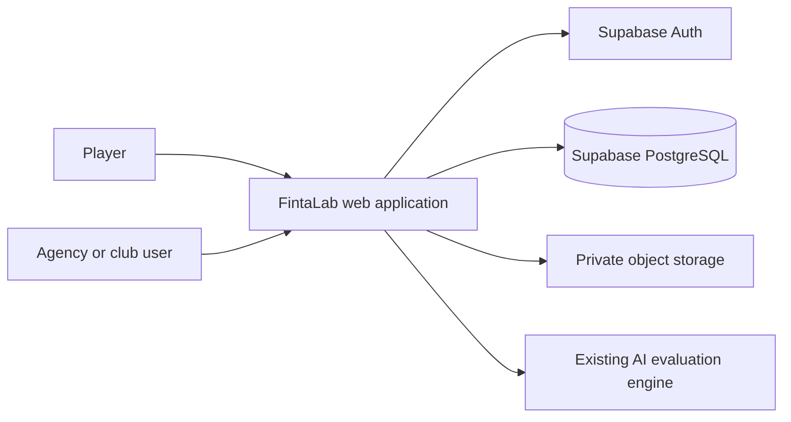
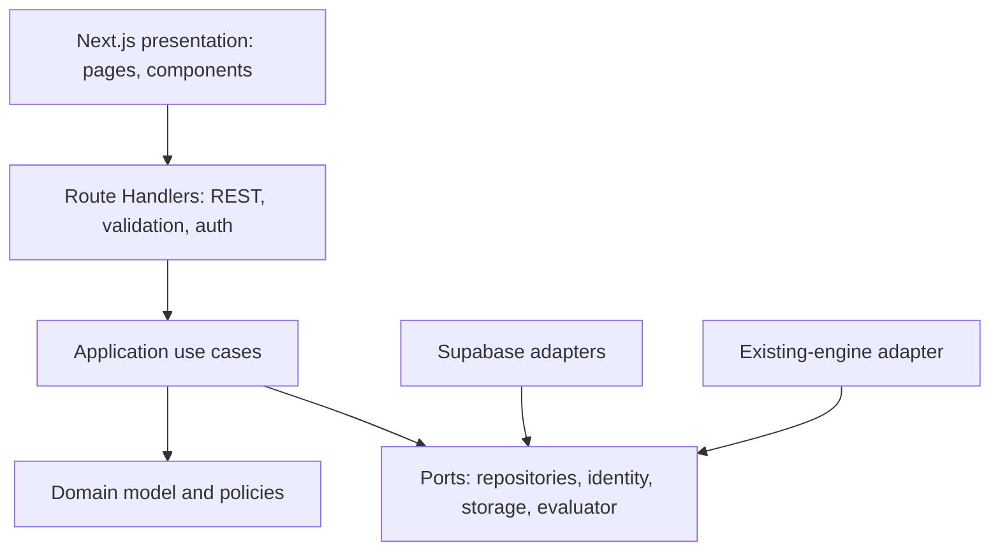

# Proposed architecture

**Status:** Provisional design; not implemented. Decisions are summarized in `adrs/`.

## Principles

Use a modular monolith, explicit domain boundaries, strict TypeScript, server-side authorization, validated contracts, and observable workflows. Apply Clean Architecture and DDD only where they protect the domain or improve testability; avoid microservices and abstraction layers without a concrete need. The domain must not depend on Next.js, React, Supabase, or Mastra.

## System context



The AI engine and its deployment contract are not present in the inspected source snapshot. The diagram is a target boundary, not a claim that these integrations exist.

## Application structure and module boundaries



Suggested modules:

- **Identity & Access:** authenticated principal, permissions, organization role checks.
- **Organizations & Membership:** agency/club lifecycle and membership.
- **Player Profiles:** private athlete profile and profile ownership.
- **Athlete Relationships:** organization-player affiliation, invitation/approval, revocation, and history.
- **Match Reports:** user-authored match context and report.
- **Evaluations & History:** submission, state transitions, immutable result snapshots, and history.
- **AI Adapter:** translation between application-owned evaluation contracts and the verified engine contract.
- **Media:** private profile imagery and upload policy.

Keep UI components presentation-focused. Application use cases coordinate authorization, persistence, and evaluation requests. Domain rules (e.g. valid state transitions and score-scale compatibility) remain independent of framework and storage.

## API and rendering

Use Next.js Route Handlers as the initial typed REST boundary; document request/response shapes and validate all untrusted input on the server. Prefer Server Components and server-side data access for read-heavy pages. Use Client Components for forms, navigation, and interactive visualizations. Native server fetching should cover initial data loads; add TanStack Query when client cache coordination, mutation invalidation, or processing-status polling has a demonstrated use. Avoid maintaining REST and tRPC for the same operations.

This trades tRPC's convenient end-to-end TypeScript inference for an explicit, framework-independent contract that is easier to document and consume from other clients. Revisit tRPC only if the product commits to a single TypeScript client and the interoperability trade-off is acceptable.

## Identity, authorization, and persistence

Use Supabase Auth as the preferred identity provider; do not store passwords in application tables. Keep authenticated user identity separate from player profiles and organization memberships. Check authorization in each server-side use case and use PostgreSQL RLS as a second tenant boundary. Use private storage for images. Never expose a service-role key to the browser. RLS design and policy tests are required before real tenant data is introduced.

## Domain model overview

An account can own a player profile, join organizations, or both. Membership grants organization-level permissions; it does not itself establish a relationship to every athlete. Athlete relationships separately govern an organization's access to a player. Each match report is evidence for an evaluation. Each completed evaluation is an immutable historical result with engine/schema version and only the attributes actually returned and validated. See [DATA_MODEL.md](./DATA_MODEL.md).

## Evaluation sequence

```mermaid
sequenceDiagram
  actor User
  participant API as Route Handler
  participant UseCase as Submit evaluation use case
  participant DB as PostgreSQL
  participant Adapter as Evaluation adapter
  participant Engine as Existing engine
  User->>API: Submit report and player reference
  API->>API: Validate input and authenticate
  API->>UseCase: Authorized command + idempotency key
  UseCase->>DB: Verify relationship; persist report and Pending evaluation
  UseCase->>Adapter: Request evaluation
  Adapter->>Engine: Map to verified engine contract
  Engine-->>Adapter: Raw result
  Adapter->>Adapter: Validate schema, scale, and version
  Adapter-->>UseCase: Validated result or explicit failure
  UseCase->>DB: Store immutable completion or failure state
  API-->>User: Status and authorized result
```

The execution model may be synchronous or background/queued after latency and hosting constraints are measured. Do not fabricate a result on timeout or engine failure.

## Evaluation states and reliability

Proposed lifecycle: `Draft -> Pending -> Processing -> Completed | Failed`. Only supported transitions may occur; `Completed` is terminal and immutable. Prevent duplicate requests using an idempotency key scoped to the authorized submitter/report. Retry failed work explicitly and retain attempt/failure history; whether retry creates a new evaluation or a distinct attempt remains a domain decision. Surface a safe failure state rather than a plausible-looking empty result.

## AI boundary

The current source suggests a sports persona, JSON-oriented text prompt, 0–99 attribute scores, and streamed OpenAI completion, but its client and supporting modules are absent and no structured response schema is verified. Before integration, establish a versioned application contract, missing-attribute representation, evidence/justification fields, runtime dependency and secret model, timeout/cost behavior, and whether the engine can be invoked as a service. An `IPerformanceEvaluationService`-style port is a conceptual boundary, not a requirement to use a C# naming convention.

Do not introduce Mastra.ai for the initial design. Reconsider only if multi-step orchestration, durable retries, or tool workflows justify its operating and testing costs. The application must remain independent of Mastra either way.

## Technology decisions and operational notes

- **Frontend:** Next.js, React, strict TypeScript, Tailwind, shadcn/ui customized to the approved tokens.
- **Quality:** Biome as the single formatter/linter if compatible with the selected test/build toolchain; Vitest and browser testing are separate responsibilities.
- **Data:** Supabase PostgreSQL with reviewed migrations in a future implementation phase; migrations are not part of this artifact.
- **Files:** private Supabase Storage bucket, with application ownership checks and restrictive upload policies.
- **Environments:** isolated local/test/preview/production projects and keys; no production data in previews; server-only secret injection; redacted structured logs and alerts for evaluation failures.
- **Observability:** correlation ID across report, evaluation, and engine invocation; log state transitions and timings without writing report text, tokens, or secrets to general logs.

## Decisions and unresolved questions

See [ADR-0001](./adrs/ADR-0001-modular-monolith.md), [ADR-0002](./adrs/ADR-0002-route-handlers-rest.md), [ADR-0003](./adrs/ADR-0003-supabase-identity-and-rls.md), [ADR-0004](./adrs/ADR-0004-modular-ai-adapter.md), [ADR-0005](./adrs/ADR-0005-evaluation-history-and-retries.md), [ADR-0006](./adrs/ADR-0006-testing-toolchain.md), [ADR-0007](./adrs/ADR-0007-private-file-storage.md), and [ADR-0008](./adrs/ADR-0008-data-fetching-and-ui-boundary.md). Key unresolved items are source/engine availability, tenancy and organization relationship consent, report visibility, minors/LGPD scope, score schema, AI execution/queue model, retry semantics, and final product scope. These recommendations are provisional and require review before implementation.
