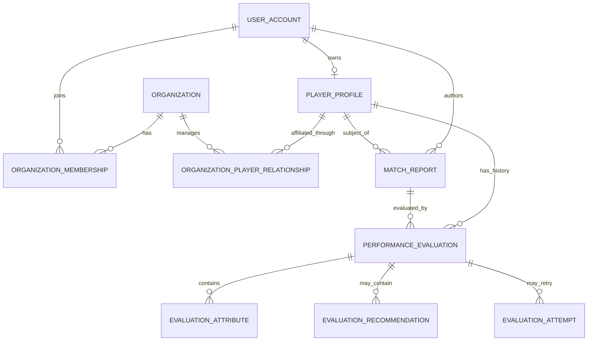

# Conceptual data model

**Status:** Conceptual only. No database schema or migrations were created.

## Entities

| Entity | Purpose and key relationships |
|---|---|
| `UserAccount` | Identity-provider subject and account lifecycle metadata. Not a player profile. |
| `PlayerProfile` | Private athlete identity and optional sporting details; optionally owned/managed by a user account. Age is derived from date of birth. |
| `Organization` | Agency or club tenant and its profile. |
| `OrganizationMembership` | User-to-organization relationship with role and status. Determines organization-level capabilities, not athlete access by itself. |
| `OrganizationPlayerRelationship` | Separate, auditable affiliation between an organization and player; records status, initiator/approval, and effective dates. |
| `MatchReport` | Match context, author, selected player, report text, optional statistics, and submission timestamps. |
| `PerformanceEvaluation` | One evaluation request/result linked to a player and report, with lifecycle, version, timestamps, and failure metadata. Completed results are immutable. |
| `EvaluationAttribute` | Attribute key, score as returned, scale/schema reference, and evidence-based justification. Missing attributes remain absent/explicitly unavailable per the verified contract; never coerce to zero. |
| `EvaluationRecommendation` | Recommendation content and its source/version, if the engine actually returns this information. |
| `EvaluationAttempt` (provisional) | Optional internal record of retries, correlation, timing, and failure outcome without overwriting a completed result. Decide if needed after execution model is known. |

## Relationships

## Invariants and constraints to preserve

- User identity, player identity, organization membership, and organization-player affiliation are distinct concepts.
- Access to an athlete must be established through ownership or an active, authorized relationship; organization membership alone must not grant access to all players.
- Every report and evaluation references its subject and authorized author/organization context. Exact ownership fields remain to be decided.
- A completed evaluation's content, attribute definitions, score scale, and engine/schema version are immutable. A subsequent analysis creates a new historical evaluation.
- Do not compare historical scores unless attribute definitions, scale, and engine compatibility are known to match.
- Do not substitute missing evidence with zero or derive an Overall score differently from the engine.
- Enforce uniqueness/idempotency for submissions at a defined scope; preserve retry and failure history.
- Use foreign keys, tenant-aware authorization, and indexes for subject/date, tenant/status, and report/evaluation lookups after workload review.
- Store timestamps consistently; derive displayed age from date of birth. Avoid persisting duplicate display values.
- Country references use an ISO 3166-1 alpha-2 code, separate from the UI language/locale. Resolve localized country names and decorative flags through one catalog rather than storing duplicated labels or emoji. In the static wireframe, player and organization country references are fictional, browser-session-only examples; this does not introduce a production schema or persistence.
- Apply explicit retention, deletion, and export policies to reports, photos, and evaluation records.

## Unresolved model decisions

Decide whether an organization relationship requires player approval, guardian approval for minors, or an invitation process; whether organizations can author reports on unclaimed players; visibility of report text versus evaluation output; whether the model supports one account with multiple profiles; the status/termination history to retain; recommendation schema; and exact missing-score serialization. These need product, legal, and engine-contract input before physical schema design.

No table names, score range beyond what the inspected sports prompt states, or production constraints should be treated as final at this stage.
