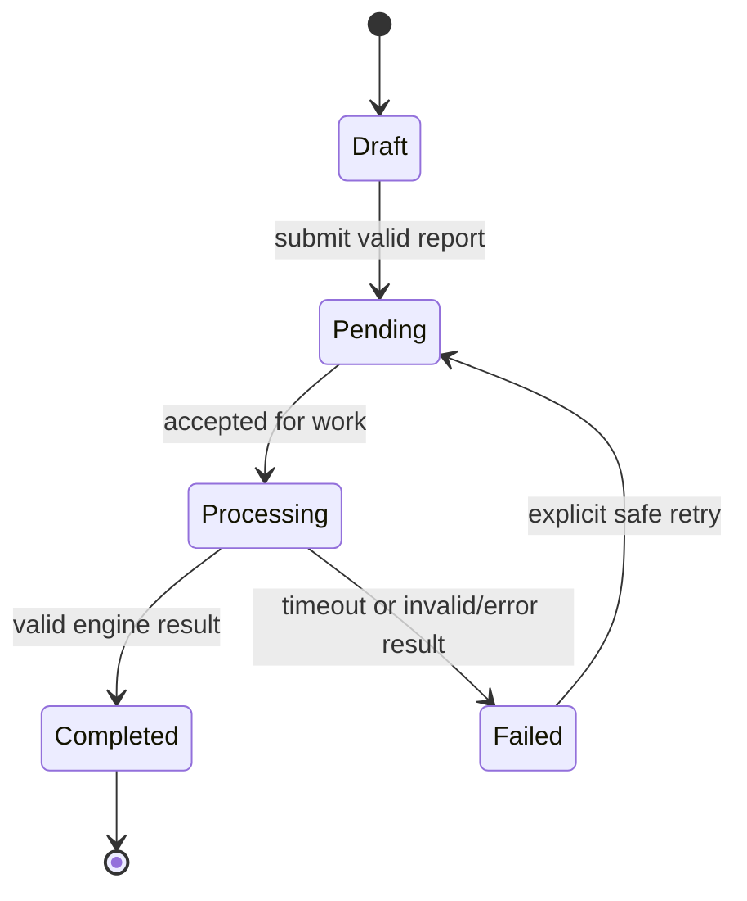

# User flows

Flows are conceptual. Every screen and interaction in the static prototype is simulated; no account or evaluation is created.

## Shared account entry

1. Landing page explains the product and privacy-first evaluation model.
2. Select player, agency, or club to show the relevant registration fields.
3. Login, forgot password, and reset password are separate visual states.
4. New users complete a profile setup step; optional sports details can be deferred.
5. Logout and access-denied states explain what happened without exposing private resource details.

## Player

1. Dashboard shows profile summary, latest evaluation if present, history, and new-report action.
2. Empty state offers profile completion and first report; it does not fabricate ratings.
3. Player enters match information and a written performance report; statistics are optional.
4. Confirmation creates a simulated processing state with a clear status.
5. Completed evaluation opens detailed attributes, evidence/justification, recommendations when supported, card, and chronological history.
6. Failure state offers an explicit retry path and preserves the original failure; it never shows invented results.

## Agency and club

1. Organization user signs in and enters its own dashboard and roster.
2. Search/filter roster, open athlete details, and review only authorized evaluations.
3. Add athlete starts a new profile or relationship request; it must not silently claim an existing athlete.
4. Edit profile and organization settings are role-gated in the future application.
5. Start evaluation from a selected athlete, enter match evidence, and follow the same processing/success/failure states as a player.
6. Revoke/terminate an athlete relationship without erasing historical ownership or audit evidence.

## Shared report and evaluation states

Retry semantics (new evaluation versus attempt) require a product decision. Completed evaluations are terminal.

## Loading, empty, error, and access states

- **Loading:** preserve context and communicate that an evaluation is in progress.
- **Empty dashboard/roster/history:** explain why the list is empty and provide an appropriate next action.
- **Validation error:** identify the field, explain correction, preserve entered values.
- **Evaluation failure:** display a safe reason category and support contact/retry; do not reveal provider secrets or raw stack traces.
- **Access denied:** do not confirm whether an unrelated private profile exists; provide a safe return path.
- **Confirmation:** state the impact of a relationship termination or destructive action before the simulated action.

## Responsive navigation

Desktop uses a persistent organization/player navigation rail and content region. Tablet collapses the rail to icons or a labeled menu. Mobile uses a compact header and accessible menu/drawer; primary actions remain visible, tables become cards or horizontally scrollable with an announced alternative, and forms become a single column.
