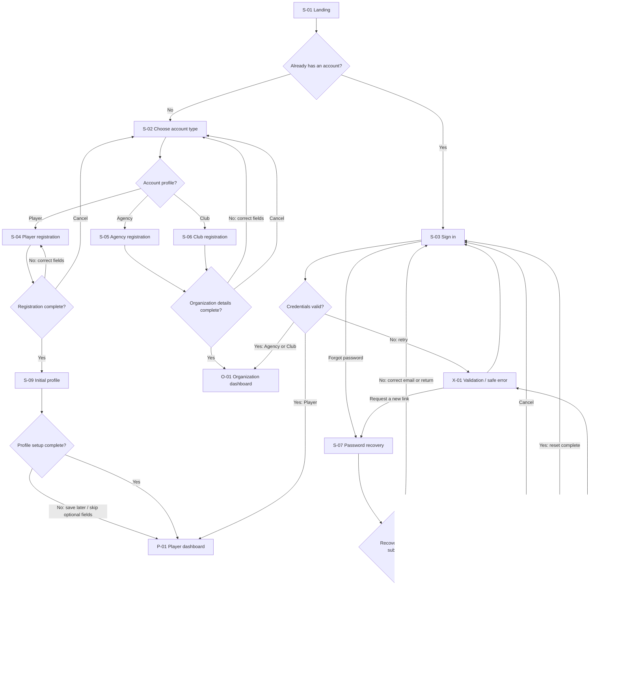
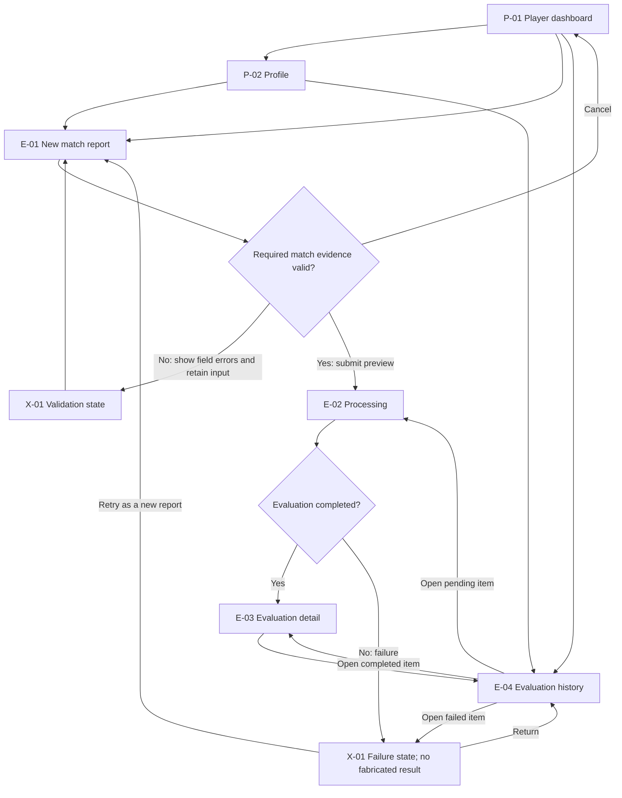
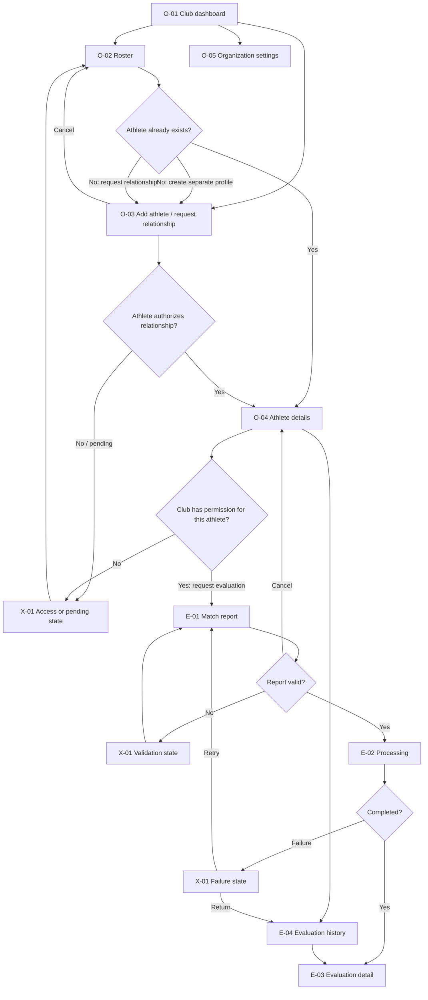

# User flows

These are conceptual product journeys shown by the static prototype. No account, profile, relationship, report, or evaluation is created or persisted. Buttons in the navigation map open the corresponding wireframe screen; form submissions only simulate the next visual state.

## Legend and screen index

- **Screen node** — a navigable prototype screen; its ID is unique and maps to the DOM screen ID.
- **Decision** — a product or validation condition; each outgoing edge is labeled.
- **Shared** — a screen/template reused by more than one profile.
- **Return** — cancel, retry, or safe navigation back to a known screen.

| ID | Screen | Prototype target |
|---|---|---|
| S-01 | Landing / platform entry | `#screen-landing` |
| S-02 | Account type | `#screen-account` |
| M-01 | Interactive navigation map | `#screen-flows` |
| S-03 | Sign in | `#screen-login` |
| S-04 | Player registration | `#screen-player-signup` |
| S-05 | Agency registration | `#screen-agency-signup` |
| S-06 | Club registration | `#screen-club-signup` |
| S-07 | Password recovery | `#screen-recovery` |
| S-08 | Password reset | `#screen-password-reset` |
| S-09 | Initial player profile | `#screen-setup` |
| P-01 | Player dashboard | `#screen-player-dashboard` |
| P-02 | Player profile and evaluations | `#screen-player-profile` |
| O-01 | Agency / Club dashboard | `#screen-org-dashboard` |
| O-02 | Organization roster | `#screen-roster` |
| O-03 | Add athlete / request relationship | `#screen-athlete-edit` |
| O-04 | Athlete details | `#screen-athlete` |
| O-05 | Organization settings | `#screen-settings` |
| E-01 | Match report | `#screen-report` |
| E-02 | Evaluation processing | `#screen-processing` |
| E-03 | Evaluation detail | `#screen-evaluation` |
| E-04 | Evaluation history | `#screen-history` |
| X-01 | Empty, validation, failure, confirmation, and access-denied states | `#screen-states` |
| V-01 | Design system showcase | `#screen-showcase` |

## A. Unauthenticated user and shared account entry

The account type is selected only at registration. Login routes to the already associated profile in the conceptual product; the role selector in the wireframe is only a preview control. Registration, recovery, reset, and login are simulations, not authentication.

## B. Player

The dashboard offers profile, history, and a new-report path. A completed evaluation opens its detail and evidence; a pending item stays in processing; a failure has no score and offers a safe return or retry. Whether retry creates a new evaluation or a new attempt is a product decision.

## C. Agency

## D. Club

Agency and Club have separate journeys and role-colored panels in `M-01`. They share organization screens and evaluation templates; switching the role preview changes the simulated organization. A relationship never grants data access by itself.

## Shared states and responsive navigation

- **Loading / processing:** keep the report context visible; do not imply progress or a result the system does not know.
- **Empty dashboard, roster, or history:** explain the empty state and offer an appropriate next action.
- **Validation:** identify fields, retain entered values, and provide a return to the form.
- **Evaluation failure:** show a safe reason category and retry/return paths; do not reveal provider secrets or stack traces, and never fabricate a result.
- **Access denied:** do not confirm whether an unrelated private profile exists; provide a safe return to the dashboard or roster.
- **Cancellation:** registration returns to account type; report cancellation returns to the player dashboard or athlete details; organization edits return to settings.
- **Relationship confirmation:** explain the effect before a future implementation revokes a relationship; preserve historical ownership and audit evidence.
- **Responsive navigation:** persistent rail on desktop, collapsible labeled navigation on tablet/mobile, single-column forms on mobile, and accessible overflow alternatives for wide tables.

`M-01` provides a navigable overview plus expandable detail diagrams. Screen nodes open the prototype screen named in the index; arrows name the triggering action or decision. These diagrams describe intended paths, not backend authorization or production business rules.
